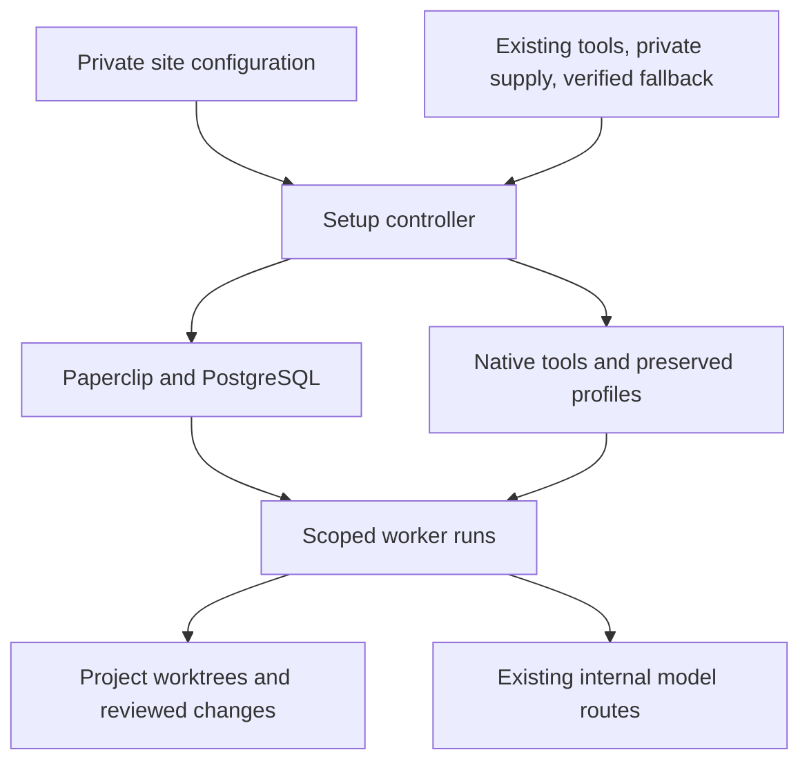

# Architecture

Agentic Foundry combines a deployment controller, a native tool installation layer, a project/task coordinator, and existing private model infrastructure. Each layer has a defined owner and produces evidence that the next layer can use.

## Deployment and execution

The controller installs and verifies selected capabilities. It does not become a second task scheduler or an inference server. The full release supplies pinned runtime/dependency artifacts; private infrastructure supplies the actual routes, identities, repositories, and site configuration.

## Ownership

| Concern | Authority |
| --- | --- |
| Projects, assignments, task dependencies, top-level runs | Paperclip. |
| Repository history and reviewable changes | Git and the project's existing review process. |
| Model/tool loop, working session, client-specific state | The selected coding harness. |
| Inference, model availability, routing, and capacity | Existing internal model infrastructure. |
| Package-owned executables and libraries | The host's native package manager. |
| Independent runtime installation and managed entry points | The selected host plan and installation receipts. |
| Existing brain, hooks, skills, and route configuration | The site's preserved configuration and explicit reviewed additions. |
| Acceptance | Actual task artifacts, deterministic checks, and reviewed target evidence. |

Worktrunk manages interactive worktrees and explicitly assigned worktrees. Paperclip already owns worktrees for its own tasks; do not let both tools independently create, rename, or clean the same checkout. Herdr is an optional terminal cockpit rather than a competing scheduler.

## Setup layers

| Layer | Main interface | Responsibility |
| --- | --- | --- |
| Repository deployment | `deploy.sh` | Verify/hydrate the local LFS payload before setup; read-only discovery/help avoid full hydration. |
| Operator entry | `setup.sh` | Select `doctor`, `plan`, `apply`, or `agent`; bootstrap a qualified controller. |
| Site compilation | `scripts/compile-site.py` | Turn actual private findings into explicit source, native, host, core, profile, and productivity plans. |
| Stage coordination | `scripts/setup.py` | Bind inputs to private state, enforce preservation, run stages, and verify completed work on resume. |
| Existing-machine boundary | `upgrade.sh` and phase controller | Claude qualifies OMP, writes a checked handoff, and stops before the operator starts phase 2. |
| Native and host installation | Native helpers and `scripts/hostctl.py` | Preserve package ownership, stage complete runtimes, verify commands, and manage reviewed entry points. |
| Core and client installation | `scripts/install-stack.py` and core controller | Compose host/native/core/profile operations and maintain their receipt bindings. |
| Productivity installation | `scripts/productivity.py` | Apply selected delivery-tool profiles and their functional checks. |
| Worker tool exposure | `scripts/stage-productivity.py` | Stage complete portable runtime trees and verify their actual worker-visible commands. |
| Payload preparation | `scripts/offline_payload.py`, `scripts/payload.py`, and release tooling | Validate the LFS reconstruction manifest, verify/hydrate pinned bytes, and support private release transfer without runtime public downloads. |

## Artifact selection

Selection follows a factual sequence:

1. Reuse an inspected adequate existing installation when its identity and dependency layout meet the selected plan.
2. Prefer an appropriate approved private package, library, image, or complete runtime artifact.
3. Select the kit fallback only with recorded evidence that the private options are unavailable, incompatible, or insufficient.

Artifact names alone do not establish compatibility. A same-name private candidate with different bytes requires inspection and qualification. Container staging requires a complete runtime archive; an otherwise usable bare host executable does not establish its dependency closure inside a worker.

The payload lock records supplied artifact identities. Site-specific selection records live in private state. Source snapshots make debugging and controlled changes possible, but they do not automatically supply every upstream build graph or a runnable payload for another architecture.

## Native layout

System package paths such as `/usr/bin` and `/usr/lib` remain under the native package manager. Complete independent tools use versioned managed directories under `/opt/agentic-stack/tools/…` in system mode, with inspected `/usr/local/bin` entry points. User mode uses corresponding user-owned locations.

Runtime libraries, scripts, native modules, and resources remain with their selected runtime. A command launcher resolves that runtime explicitly. Host installation and container exposure are separate checks: a working host command does not prove the worker can execute it.

Canonical path replacement requires inspection of the existing occupant and verification of the selected candidate. Cleanup follows acceptance and ownership checks; it does not recursively remove a shared directory based only on an unusual path.

## State and preservation

| State | Location and treatment |
| --- | --- |
| Public setup source and examples | Versioned repository. |
| Offline artifacts and source snapshots | Verified release payload, with LFS transport described in [Offline payloads](PAYLOADS.md). |
| Site declarations and private source findings | Operator-owned paths outside Git. |
| Setup transactions and installation receipts | Private setup state, bound to exact input identities. |
| Original profile baseline and reviewed changes | Private upgrade state, retained across both phases. |
| Application/database and worker session data | Explicit persistent target locations selected by the site. |
| Project changes | Scoped project worktrees and their Git history. |

A changed plan is a new reviewed transaction. It is not a reason to refresh the original baseline or discard evidence of a configuration change. Profile preservation includes effective launch context, named profiles, wrappers, environment-selected locations, external brain files, hooks, skills, model routes, credential sources, and CA trust.

## Worker integration

Portable Worktrunk, RTK, Zoekt/Ctags, and language-service trees can be exposed through Paperclip's existing read-only runtime mount. The staging helper preserves untracked or edited commands and binds its report to exact source receipts. Its container probes must pass on the actual target.

The supplied browser and evaluation profiles are native host capabilities. Browser-driven work needs a native worker lane or a separately qualified private image with matching browser dependencies. The release does not assume Debian browser libraries are present in the pinned Paperclip image.

## Acceptance boundaries

Qualification progresses from file identity to functional capability to real delivery:

- Checksums establish which bytes were supplied.
- Native runtime checks establish that selected commands and dependency layouts work in their tested context.
- Worker probes establish that the commands are actually available in the selected worker environment.
- Real internal-model tasks establish protocol, tools, session behavior, and project delivery for that configuration.
- Explicit admission enables an accepted worker for ordinary task dispatch.

Controller tests use isolated fixtures for model, Docker, and privileged actions. They protect installation logic but do not claim target-machine acceptance. No extra monitoring, telemetry, backup, or memory platform is required by this architecture.
